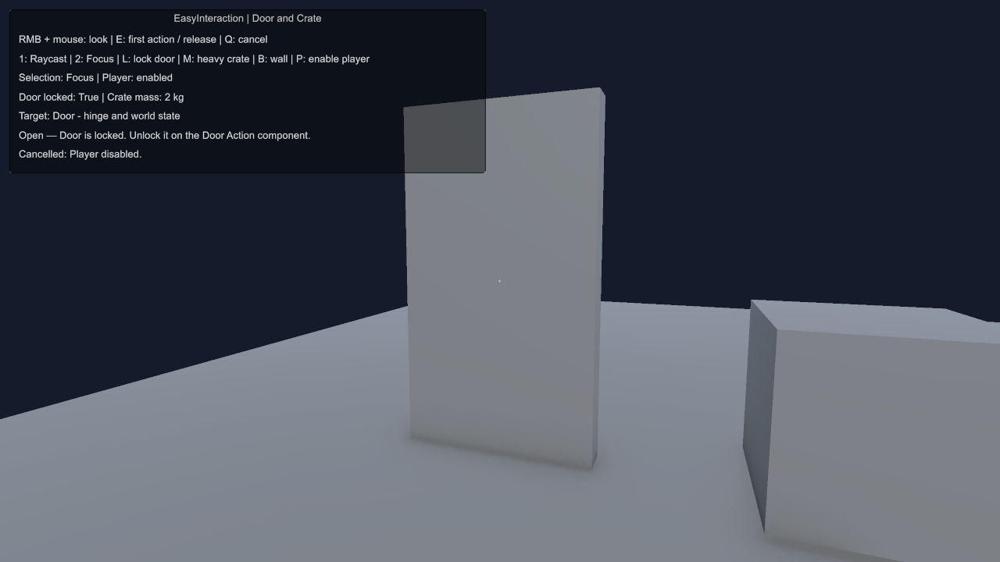

# Проверка EasyInteraction 0.1.0 — 11 ноября 2026

Поправка измерений GC от 12 ноября 2026: прежний GC.GetAllocatedBytesForCurrentThread не прошёл положительный контроль на этом Editor. Старые нули и основанные на них выводы zero GC отозваны; raw JSON сохранены без изменений. Данные CPU и функциональные результаты рассматриваются отдельно. См. [отчёт об исправлении измерителя](Reports/GcRecorderRepair/README.md).

Проверено на **Unity 6000.3.22f1**, Input System **1.20.0**, Test Framework **1.6.0**. Управление редакторами, создание сцен, импорт Samples, тесты и сборки выполнены через Unity CLI / Pipeline **0.10.0-exp.1**.

## Функциональные результаты

| Проверка | Результат | Исходный отчёт |
| --- | --- | --- |
| Компиляция Games Factory после восстановления общих настроек | Без ошибок, Editor ready, Play Mode stopped | [compile-final.json](Validation/compile-final.json) |
| PlayMode, Games Factory | **24 / 24**, 0 skipped, 5.26 с | [playmode-main.json](Validation/playmode-main.json) |
| PlayMode, чистый проект | **24 / 24**, 0 skipped, 5.27 с | [playmode-clean.json](Validation/playmode-clean.json) |
| Готовая сцена в Games Factory | Все проверки true для Raycast и Focus | [sample-main.json](Validation/sample-main.json) |
| Импортированная сцена в чистом проекте | Все проверки true для Raycast и Focus | [sample-clean.json](Validation/sample-clean.json) |
| Development Player с нагрузочным стендом | Succeeded, **0 ошибок / 0 предупреждений**, 16.9 с | [build-main.json](Validation/build-main.json) |
| Development Player с Sample из чистого проекта | Succeeded, **0 ошибок / 0 предупреждений**, 42.6 с | [build-clean.json](Validation/build-clean.json) |

Тесты покрывают: блокировку стеной и отказ устаревшей кнопки UI в обоих режимах; дверь и независимость её состояния от фокуса; несколько действий, причины недоступности и события; устойчивость двух конкурирующих целей; радиус, сектор и видимого кандидата за перекрытым лидером; переполнение overlap-буфера (141 цель) и ray-буфера (40 коллайдеров игрока); E/Q через Input System; повторные вызовы; двух игроков; предел массы/дальности/кинематическое тело; отключение Actor, Target, Action и Input; уничтожение удерживаемого объекта; отмену из callback; столкновение со стеной; три шага физики; разрыв захвата при удалении игрока.

В тесте синтетической клавиатуры временно включается доставка ввода без фокуса Game View, затем исходные Input Settings восстанавливаются. Runtime не меняет эти настройки. В общей сцене действия дополнительно проверены через обычные `RefreshTarget`, `Check`, `TryExecute`, `Interact`, `Cancel` и выключение Actor.

## Чистая установка и инструкция первого запуска

Создан отдельный проект шаблона **3D Built-In** в `Temp/EasyInteraction/EasyInteractionClean`, без других Easy-пакетов. EasyInteraction установлен как local UPM package; добавлены Pipeline и Test Framework только для проверки. [Сохранённый manifest](Validation/clean-manifest.json).

Пройден путь README: пакет разрешился; `Active Input Handling = Input System Package (New)` уже установлен шаблоном; **Door and Crate** импортирован через публичный `UnityEditor.PackageManager.UI.Sample.Import`; точное меню **Tools > Easy Interaction > Create Door and Crate Scene** создало сцену; затем открыта именно импортированная `Assets/Samples/EasyInteraction/0.1.0/Door and Crate/DoorAndCrate.unity`. В Play Mode дверь открылась, запертая дверь вернула причину отказа, ящик захватился и отпустился, стена убрала цель, выключение игрока освободило Rigidbody — в обоих режимах. Затем импортированная сцена успешно собрана.

Никаких ручных исправлений ссылок, дополнительных компонентов, материалов или пакетов Easy для первого запуска не понадобилось. Проверка выполнена средствами CLI и публичными API редактора, а не физическими щелчками мыши. Точная E/Q-проводка отдельно проверена синтетическим устройством Input System. В обычном редакторе нужно дать фокус Game View, как указано в README.

## Производительность в Player

**Windows 11 x64**, Intel **Core i7-14700KF**, 28 логических потоков, **RTX 4070 Ti SUPER**, 65 309 MB системной памяти по SystemInfo. Сборка **Development / Mono**, без Deep Profiling, без Script Debugging, 640×360, graphics включён, `-batchmode`, VSync выключен. Финальный прогон выполнен после завершения компиляций и сборок; чистый Editor закрыт. Jobs/Burst не использовались.

Исходники стенда: [Tools~/Performance](../Tools~/Performance). [Полный итоговый JSON](Validation/benchmark-final.json), [первый замер до изменения лучей](Validation/benchmark-before.json). 64 прогревочных вызова, затем 160 измерений `RefreshTarget` в каждом сценарии. CPU — Stopwatch вокруг публичного метода; GC измерялся некалиброванным `GC.GetAllocatedBytesForCurrentThread`; эти показатели недостоверны. Поиск не ограничивает число возвращаемых целей: массивы растут, если физический запрос заполнил весь буфер.

| Число целей | Focus: среднее / p95, мс | Частая смена, мс | Все закрыты стеной, мс | GC после прогрева |
| ---: | ---: | ---: | ---: | ---: |
| 16 | 0.0124 / 0.0140 | 0.0140 | 0.0257 | недостоверно |
| 128 | 0.0975 / 0.1040 | 0.0961 | 0.1907 | недостоверно |
| 1024 | 0.9041 / 1.0740 | 0.8351 | 1.5488 | недостоверно |
| 4096 | 4.0419 / 4.8451 | 4.0848 | 9.3529 | недостоверно |

В обычном Focus — один overlap + один луч видимости, независимо от числа кандидатов. В `Focus switching` за 160 вызовов произошло **160 реальных смен цели**; прежний вывод об отсутствии аллокаций отозван. В полностью перекрытом случае — N проверок видимости и N+1 физических запросов. Вместимость overlap-буфера на 4096 целях — 8192; жёсткого отбрасывания хвоста нет.

Эталонный последовательный поиск проверяет видимость **всех** кандидатов перед выбором лучшего. Совпадение с публичным `RefreshTarget`: **1920 / 1920**, включая порог переключения и полностью закрытые цели. Для видимых 16/128/1024/4096 целей эталон занял 0.0175/0.1456/1.2168/5.0646 мс: выбранный порядок проверок сократил время примерно на **29% / 33% / 26% / 20%** в этом же прогоне. При полном перекрытии эталон быстрее: на 4096 целях 6.7122 мс против 9.3529 мс. Сортировка полезна, когда видимый победитель находится рано, и добавляет стоимость, когда нужно проверить всех.

После первого замера добавлен короткий путь `Physics.Raycast` для ближайшего препятствия; собирание всех попаданий остаётся для фильтрации собственных коллайдеров игрока. Абсолютное время самого тяжёлого сценария между отдельными прогонами **не улучшилось**: 9.27 → 9.35 мс. Поэтому отдельное ускорение этой правки не заявляется. Колебания CPU между прогонами заметны также у эталона; приведённое выше сравнение выполнено внутри одного финального прогона.

Raycast при поворотах камеры в разреженной сетке: около **0.00045–0.00046 мс**, один запрос; прежнее показание 0 B GC недостоверно. Эти лучи проходили между мелкими коллайдерами (`targetChanges=0`), поэтому это измерение промаха, а не успешных частых наведений. Реальные частые переключения измерены для Focus; успешный Raycast функционально проверен тестами и Sample.

Память всего стенда (включая эталон, графику и Unity), а не только кода пакета:

| Целей | Managed used, MiB | Unity allocated, MiB | Unity reserved, MiB |
| ---: | ---: | ---: | ---: |
| 16 | 1.67 | 57.58 | 193.61 |
| 128 | 1.90 | 57.93 | 193.61 |
| 1024 | 4.05 | 60.73 | 193.61 |
| 4096 | 11.68 | 71.45 | 210.61 |

## Физическое удержание в Player

**9 / 9 сочетаний прошли**: 30/60/144 FPS × `fixedDeltaTime` 1/30, 0.02, 0.01 с. Измеренная частота: 29.99–30.57, 59.96–60.00, 143.88–143.98 FPS. В каждом случае ящик захвачен, сохранено владение, координаты конечны, ящик не прошёл сквозь стену и исходные настройки Rigidbody восстановились при отключении Actor.

После 0.5 с установления максимальная ошибка относительно неподвижной точки удержания — **3.08 мм**, в конце 1.5 с — менее **0.001 мм**. Затем точка переносится за стену; за следующие 0.8 с центр ящика остаётся перед ней. Это проверка подтягивания и упора в стену, не тест произвольной скорости движущегося игрока или произвольной формы коллайдера.

Маркер `EasyInteraction.HoldPhysics`: **1.70–21.93 мкс на кадр рендера** в разных сочетаниях FPS/шага (в кадре может быть несколько FixedUpdate). В первом интервале измерено **160 B GC всего кадра** за 1.5 с; в остальных восьми — **0 B**. Эти 160 B не приписываются пакету: счётчик охватывает весь кадр и первое использование стенда. Регулярные аллокации в последующих интервалах не наблюдались.

## Оставшиеся границы и состояние проекта

- Полностью закрытые тысячи целей — дорогой случай; на этом компьютере 4096 целей требуют около 9.35 мс. Уменьшайте Range/Target Layers до нужной области. Пространственное ускорение или Jobs в эту версию не включены.
- Focus использует одну точку видимости; это не подсчёт видимых пикселей объекта. Начальный рост буферов выделяет память.
- Протестированы стандартный динамический Box Collider и значения пружины по умолчанию. Экстремальные массы, формы, очень большие скорости и необычные настройки solver требуют проверки в конкретном проекте.
- Сценарий FPS-передвижения с самим EasyMovement и вызовы EasyFeedbacks не запускались: интеграция выполняется через Transform камеры и события, без компилируемых зависимостей. Подбор EasyResources в версии 0.1.0 отсутствует.
- Общий Editor возвращён к исходной `Assets/Scenes/SampleScene.unity`, Play Mode остановлен, автоимпорт включён. Из общего manifest удалена только временная запись EasyInteraction в `testables`; существующие записи сохранены. Чистый тестовый Editor закрыт. Собственная блокировка освобождена в `finally`.

Рабочие сцены остаются в `Assets/PackageTests/EasyInteraction`; пользовательский пример — в `Samples~`. Изменения находятся в локальном репозитории пакета; публикация и push не выполнялись.
