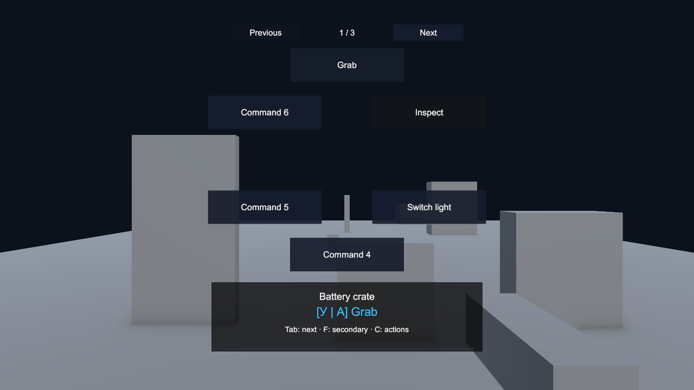

# Проверка EasyInteraction 0.2 — 12 ноября 2026

Поправка измерений GC от 12 ноября 2026: прежний GC.GetAllocatedBytesForCurrentThread не прошёл положительный контроль на этом Editor. Старые нули и основанные на них выводы zero GC отозваны; raw JSON сохранены без изменений. Данные CPU и функциональные результаты рассматриваются отдельно. См. [отчёт об исправлении измерителя](Reports/GcRecorderRepair/README.md).

Unity **6000.3.22f1**, Input System **1.20.0**, Test Framework **1.6.0**, Unity CLI / Pipeline **0.10.0-exp.1**. Основная разработка и интеграции проверены в Games Factory. Чистый проект создан отдельно, без других Easy-пакетов; в нём установлены NGO **2.7.0**, Transport **2.7.4** и XRI **3.2.2** для проверки соответствующих Samples.

## Функциональная проверка

| Проверка | Результат | Отчёт |
| --- | --- | --- |
| PlayMode: ядро, Resources, Combat, Building, Movement, UI | **82/82**, без пропусков | [tests-main-final.json](Validation-v0.2/tests-main-final.json) |
| PlayMode: чистая установка, ядро и настоящий XRI | **73/73**, без пропусков | [tests-clean-final.json](Validation-v0.2/tests-clean-final.json) |
| NGO: два отдельных Windows Player по loopback | Оба passed=true | [server](Validation-v0.2/network-server-final.json), [client](Validation-v0.2/network-client-final.json) |
| Package Manager: импорт готовой Gallery | 7 целей, 2 участника, 0 missing scripts | [clean-gallery-import.json](Validation-v0.2/clean-gallery-import.json) |
| Чистая Gallery: дверь, перенос, вставка, извлечение | Все проверки true | [actions](Validation-v0.2/clean-gallery-actions.json) |
| Настоящее событие AnimationClip, совместная работа | Один эффект; прогресс 1, участники освобождены | [animation](Validation-v0.2/clean-gallery-animation.json), [cooperation](Validation-v0.2/clean-gallery-cooperation.json) |
| Development Player с нагрузкой | Succeeded, **0 ошибок / 0 предупреждений** | [performance-build-final.json](Validation-v0.2/performance-build-final.json) |
| Development Player с импортированной Gallery | Succeeded, **0 ошибок / 0 предупреждений** | [gallery-build-final.json](Validation-v0.2/gallery-build-final.json) |

В двух наборах повторяются 71 тест ядра; это не 155 независимых сценариев. Дополнительно выполнены 11 тестов интеграций и 2 теста XRI. Покрыты поиск/переполнение буферов/преграды/части объектов, ввод, пауза/подтверждение/анимационный commit, устаревшие tickets, исключения и отмена из callbacks, условия, каналы/места/очереди, кооперация, этапы, сокеты, передача и два владельца, сохранения, ресурсные резервы/частичная оплата/атомарная передача, смерть/revive, отдельные строительные сессии, перекрывающиеся блокировки ввода и страницы UI.

Сетевой тест проверяет начальное состояние при подключении, дверь, отпускание кнопки до ответа сервера, отказ вне радиуса, живую репликацию рычага, эксклюзивный захват и освобождение с восстановлением Rigidbody при отключении. `disconnectedCleanup=false` в клиентском JSON означает, что эта проверка выполнялась только сервером; оба процесса завершились успешно. Проверка сети — локальный транспорт, не испытание WAN/потерь пакетов.

Визуально проверены список, круг и 13 команд на трёх страницах. Временные дополнительные команды созданы только в Play Mode. [Контрольный вид меню](Validation-v0.2/gallery-pages-final.png):

## CPU и GC в сборке

Windows 11 x64, **Core i7-14700KF**, 28 логических потоков, **RTX 4070 Ti SUPER**, 65 309 MB RAM по SystemInfo. Development / Mono, без Deep Profiling и Script Debugging, 640×360, графика включена, VSync выключен, batchmode. Собственный чистый Editor закрыт, общий Editor оставлен без Play Mode; наши компиляции/сборки завершены. Это замер на рабочем компьютере, а не изолированная лаборатория.

[Полный JSON](Validation-v0.2/benchmark-v0.2-final.json), `passed=true` — исторический флаг, не доказательство zero GC. 64 прогрева и 160 вызовов RefreshTarget на сценарий; CPU — Stopwatch, выделения измерялись некалиброванным GC.GetAllocatedBytesForCurrentThread и признаны недостоверными. Эталон полностью перебирает кандидатов и проверяет их видимость с теми же базовыми оценками и порогом переключения.

| Целей | Focus: среднее / p95, мс | Частые переключения, мс | Все закрыты стеной, мс | GC после прогрева |
| ---: | ---: | ---: | ---: | ---: |
| 16 | 0.0118 / 0.0129 | 0.0118 | 0.0254 | недостоверно |
| 128 | 0.0842 / 0.0960 | 0.0840 | 0.2045 | недостоверно |
| 1024 | 0.6611 / 0.7094 | 0.6505 | 1.6768 | недостоверно |
| 4096 | 2.6966 / 2.8693 | 2.6173 | 6.9841 | недостоверно |

Совпадение Focus с эталоном: **1920/1920**. Во всех восьми сценариях Focus/Raycast switching произошло **160 реальных смен цели**; прежний вывод GC = 0 B отозван. В первом пробном прогоне камеры были недостаточно разнесены для двух размеров популяции; итоговый стенд направляет камеру к противоположным краям сетки и автоматически требует переключений. Raycast switching: среднее **1.37–3.08 мкс**, p95 **1.3–2.0 мкс**. Среднее первого сценария включает редкий выброс, поэтому оно выше p95.

На 4096 видимых целях эталон занимает 5.3068 мс против 2.6966 мс — около **49% сокращения времени внутри того же прогона**. При полном перекрытии эталон быстрее: 5.7552 мс против 6.9841 мс. Поддержка ранжирования выгодна при раннем нахождении видимой цели и имеет цену при проверке всех кандидатов. Первоначальный рост буферов выделяет память, результаты не обрезаются. Эталон здесь проверяет одинаковые приоритеты и одну точку; многоточечный/составной выбор проверен функциональными тестами.

| API, 512 замеров после 128 прогревов | Среднее / p95, мкс | Ошибки | GC |
| --- | ---: | ---: | ---: |
| Мгновенное действие | 3.17 / 3.4 | 0 | недостоверно |
| Tick длительного действия | 1.92 / 2.0 | 0 | недостоверно |
| InteractionAuthority.Process | 3.82 / 4.0 | 0 | недостоверно |

Измеряется ядро, а не JSON/NGO, создание компонентов, UI-построение или подписки. Они могут выделять память.

Память всего стенда, включая эталон и Unity:

| Целей | Managed used, MiB | Unity allocated, MiB | Unity reserved, MiB |
| ---: | ---: | ---: | ---: |
| 16 | 1.68 | 57.68 | 193.61 |
| 128 | 2.07 | 58.02 | 193.61 |
| 1024 | 5.45 | 60.81 | 193.61 |
| 4096 | 18.97 | 71.52 | 210.61 |

## Физическое удержание

**9/9**: 30/60/144 FPS × fixedDeltaTime 1/30, 0.02, 0.01 с. Во всех случаях сохранено владение, координаты конечны, предмет удерживается перед стеной, настройки Rigidbody восстановлены. Измеренная частота — примерно 30–30.65, 60 и 144 FPS.

После 0.5 с установления максимальная ошибка неподвижной точки — **3.08 мм**. Затем 1.5 с камера движется по X = 0.45·sin(2t) м и yaw = 20·sin(1.5t) градусов. Максимальная ошибка в движении — **0.150–0.201 м**, при пороге стенда 0.5 м; удержание не разрывается. После этого проверяется упор в стену и отпускание.

Маркер HoldPhysics: **1.02–16.63 мкс на кадр рендера**; в кадре может быть несколько FixedUpdate. Счётчик GC всего кадра за первый интервал показал **222 B**, в остальных восьми — **0 B**. Это не изолированный счётчик аллокаций Grab, поэтому первые 222 B не приписываются пакету.

## Границы и восстановление проекта

- Проверены Windows x64 / Mono и конкретная физическая сцена. IL2CPP, мобильные платформы, нестандартные формы/массы и экстремальное движение отдельно не проверялись.
- XRI проверен настоящими компонентами/событиями менеджера; физического HMD не было.
- Navigation, Localization и Feedbacks скомпилированы с реальными зависимостями. Произвольные маршруты NPC, таблицы переводов и наборы эффектов конкретной игры не проходили полноценное игровое испытание.
- Тысячи перекрытых объектов остаются дорогим случаем. Ограничивайте Range/Target Layers; Jobs/Burst в эту версию не добавлялись.
- Общий Editor возвращён к SampleScene, Play Mode остановлен, исходная сцена не изменена. Из manifest убрана только временная запись EasyInteraction в testables; запись EasyCombat сохранена. [Состояние редактора](Validation-v0.2/editor-restored.json).

Исходники повторяемых проверок: [Tools~/README.md](../Tools~/README.md). Предыдущие результаты сохранены отдельно: [Validation-v0.1.md](Validation-v0.1.md). Изменения остаются локальными; публикация и push не выполнялись.
